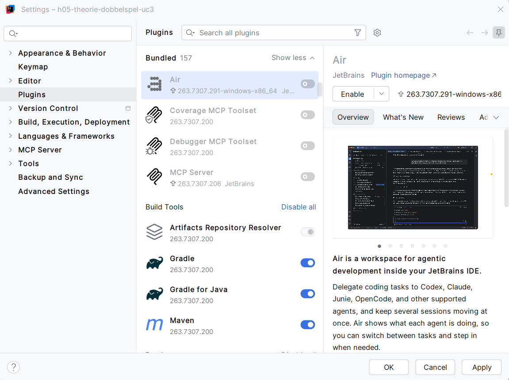

### Uitschakelen 'Air' en 'MCP Server' ⚠️verplicht⚠️
Tijdens het maken van oefeningen en op het examen is het gebruik van AI-ondersteuning niet toegestaan. De gebundelde plugins genaamd _Air_ en _MCP Server_ **moeten uitgeschakeld worden**. Andere AI-gerelateerde plugins zoals _JetBrains AI Assistant, GitHub Copilot, Tabnine, Codeium, en aanverwanten_ mogen ook niet geïnstalleerd zijn.

!!! note "Stappenplan"
    - Start IntelliJ op
    - Open het **Settings**-menu: 
        - Windows/Linux: ++"Ctrl"++ + ++"Alt"++ + ++"S"++
        - macOS: ++"Cmd"++ + ++","++
    - Navigeer in het linkermenu naar Plugins
    - Schakel de plugin **Air** uit.
    - Schakel de plugin **MCP Server** uit.
    - Klik op ++"OK"++ (of ++"Apply"++) om de wijzigingen op te slaan en **herstart IntelliJ** om de wijzigingen definitief toe te passen.

  

> **💡Tip**: in IntelliJ kan je steeds **dubbel klikken op ++"Shift"++** om een _'Search everywhere'_ zoekactie te starten. Dubbel ++"Shift"++ en in de zoekbalk _'plugins'_ intikken brengt je direct naar de gewenste sectie...

!!!warning "Belangrijk tijdens evaluaties en examens"
    Tijdens een toets of examen worden je instellingen gecontroleerd door een toezichter. Ingeschakelde AI-plugins, actieve inline completion of externe AI-tools tijdens een evaluatie worden beschouwd als **onregelmatigheid (examenfraude)** volgens het onderwijs- en examenreglement (OER).
